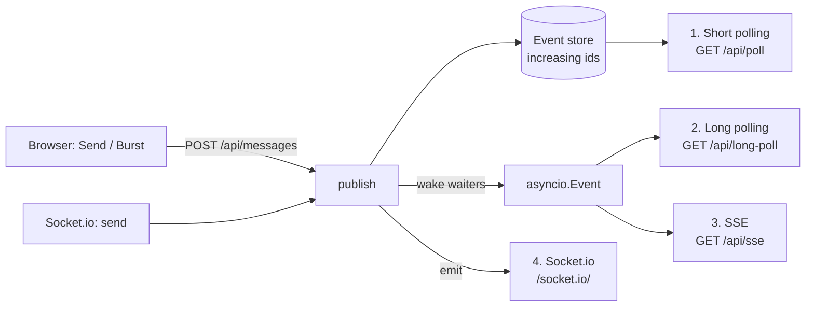

# Realtime Playground

LIVE: https://realtime-playground-rcvp.onrender.com

A hands-on comparison of the four main ways to get live updates from a server into a browser: **short polling**, **long polling**, **Server-Sent Events (SSE)** and **Socket.io (WebSocket)**.

One FastAPI server delivers the same stream of messages to the browser all four ways, side by side. Each panel measures how many requests it made, how many came back empty, and how late each message arrived. A "drop all connections" button forces the server to hang up on everyone, so you can watch how each technique recovers.

This is a learning project, built to understand the trade-offs by observing them rather than reading about them.

<!-- Add a screenshot or GIF of the four panels here, e.g. during "Drop all connections" -->
<!--  -->

## Tech stack

- **Backend:** Python, FastAPI, Uvicorn, python-socketio
- **Frontend:** plain HTML + JavaScript (`fetch`, `EventSource`, Socket.io client)
- **Storage:** in memory (no database)

## Quick start

Requires Python 3.10+.

```bash
python -m venv .venv
source .venv/bin/activate            # Windows: .venv\Scripts\activate
pip install fastapi "uvicorn[standard]" python-socketio

uvicorn main:asgi_app --reload --timeout-graceful-shutdown 2
```

Open http://localhost:8000 and keep **DevTools → Network** open next to it.

> Run `main:asgi_app`, not `main:app`. `asgi_app` is FastAPI wrapped by Socket.io; with `main:app` every `/socket.io/` request returns 404.
> `--timeout-graceful-shutdown 2` stops `--reload` from hanging on open SSE streams.

## Project structure

```
main.py            server: event store + all four transports + chaos/stats endpoints
public/index.html  four side-by-side panels and controls
public/app.js      one client per technique, plus metrics
```

## How it works



### The cursor: one idea behind all four

Every message gets an **increasing id**. Every technique asks the same question: *"give me everything after id N"*. The client remembers the last id it saw and sends it when it asks again or reconnects:

| Technique   | How the client sends its last id                    |
|-------------|-----------------------------------------------------|
| Short poll  | `?since=N` query parameter                          |
| Long poll   | `?since=N` query parameter                          |
| SSE         | `Last-Event-ID` header (the browser adds it on reconnect) |
| Socket.io   | `auth: { lastId }` in the connection handshake      |

Because of this, nothing is lost during a disconnect: the server replays the gap, and the client ignores anything it has already seen.

### Waking up waiting clients

Long polls and SSE streams wait on an `asyncio.Event`. On every publish, the server sets the current Event (waking every waiter at once) and immediately replaces it with a fresh one for the next round. Each waiter then reads the events after its own cursor.

### The four techniques

| | Short polling | Long polling | SSE | Socket.io |
|---|---|---|---|---|
| Endpoint | `GET /api/poll` | `GET /api/long-poll` | `GET /api/sse` | `/socket.io/` |
| How it works | Client asks every 3s; server answers immediately | Server holds the request until a message arrives or 25s pass | One HTTP response that never ends; server writes frames into it | Persistent two-way connection |
| Direction | Pull | Pull (feels like push) | Server → client | Both ways |
| Delivery delay | ~half the interval | A few ms | A few ms | A few ms |
| On disconnect | Nothing to reconnect | Client retries with 2s backoff | Browser reconnects and resumes by itself | Library reconnects, except after a server kick |

## Things to try

1. **Leave it idle for 30s.** Short polling keeps counting empty responses. Long polling times out every 25s and asks again. SSE and Socket.io sit quietly on one connection each.
2. **Send a message** and compare *avg delay*: short polling is the only one with real lag.
3. **Watch the Network tab:**
   - `poll`: a steady stream of short requests
   - `long-poll`: requests that stay *pending* until a message arrives
   - `sse`: one request that never finishes; the **EventStream** tab shows each frame and its id
   - `socket.io`: a few `transport=polling` requests, then a `websocket` row with status **101**; the **Messages** tab shows frames in both directions
4. **Burst ×5.** Long polling's request count jumps, since each message can release the held request. SSE and Socket.io get 5 frames on the same connection.
5. **Drop all connections.**
   - Short polling doesn't notice; it holds nothing open.
   - Long polling gets a 503 and retries after 2s.
   - SSE reconnects after 3s and resumes via `Last-Event-ID`, with no client code.
   - Socket.io gets reason `io server disconnect` and does **not** auto-reconnect, by design; the client reconnects manually.
6. **Restart the server** and send a message without reloading the page. Every panel detects the new epoch and resets its cursor.
7. **Open 5+ tabs.** Over HTTP/1.1, browsers allow about 6 connections per host, so the held SSE streams and long-polls start starving newer tabs. HTTP/2 removes this limit.

## API reference

### HTTP

| Method | Path | Purpose |
|---|---|---|
| `POST` | `/api/messages` | Publish a message. Body: `{"text": "..."}` (1–200 chars, validated by Pydantic) |
| `POST` | `/api/burst` | Publish 5 messages at once |
| `GET` | `/api/poll?since=N` | Short polling: events after id N, immediately |
| `GET` | `/api/long-poll?since=N` | Long polling: waits up to 25s for events after id N |
| `GET` | `/api/sse?since=N` | SSE stream (`text/event-stream`); honours `Last-Event-ID` |
| `POST` | `/api/chaos/drop` | Server hangs up on every held long-poll, SSE stream and socket |
| `GET` | `/api/stats` | Open SSE streams, waiting long-polls, sockets, total events, epoch |

Interactive docs: http://localhost:8000/docs

### Socket.io events

| Direction | Event | Payload |
|---|---|---|
| client → server | `send` | `{ text }`, acked with `{ ok, id }` or `{ ok: false, error }` |
| client → server | `rtt` | a timestamp, echoed back in the ack (used to measure round trip) |
| server → client | `hello` | `{ resumedFrom }` on every connect |
| server → client | `update` | a published event |

### Event shape

```json
{ "id": 7, "epoch": "5cc94bcd", "text": "hello", "at": 1793297977783 }
```

`at` is the server time in milliseconds, so the browser can compute delivery delay.

## What I learned

**Grab the signal before checking the data.** In the SSE loop, each `yield` can hand control back to the server, and a message can be published during that pause. Grabbing the `asyncio.Event` *after* sending the backlog would miss that message until the next one arrived. Grabbing it *before* means a publish in between leaves the Event already set, so the wait returns immediately. Long polling didn't need this, because asyncio only switches tasks at an `await`, and there is none between the check and the wait.

**In-memory ids break on restart.** After a restart, ids started again at 1 while browsers still held a higher last id, so they silently ignored every new message. Fix: a random **epoch** per server run, stamped on every event. Clients reset their cursor when it changes, and the server treats any cursor higher than it has ever issued as coming from before a restart. A production system would persist ids instead (e.g. a database sequence).

**Heartbeats are how the server finds dead clients.** A server often only learns a client has gone when a write fails. The SSE `: ping` every 15s keeps proxies from closing idle streams, and also forces that write.

**Socket.io doesn't reconnect after a server kick.** It reconnects automatically after network loss (`transport close`), but not after `io server disconnect`, because the server presumably meant it.

**Small FastAPI gotchas:**
- `app.mount("/", StaticFiles(...))` must come after all routes; a mount at `/` matches everything.
- Endpoints touching `asyncio.Event` must be `async def`; plain `def` endpoints run in a thread pool.
- Keep a reference to tasks from `asyncio.create_task`, or they can be garbage-collected mid-run.

## Limitations

- Everything lives in one process's memory. With `--workers 4` or multiple instances, a message published on one never reaches clients of another.
- The event store keeps the last 1,000 events; a client further behind than that misses events.
- No authentication, rate limiting or persistence.
- Delivery delay is accurate only because client and server share a clock on the same machine.

## Next steps

- [ ] Replace the in-memory store and `asyncio.Event` with a shared backplane (RabbitMQ fanout exchange, Redis pub/sub, or Postgres `LISTEN/NOTIFY`) and run two instances
- [ ] Persist event ids in PostgreSQL so the epoch workaround isn't needed
- [ ] Authenticate on connect (token in the Socket.io `auth` payload; cookie for SSE) and check `Origin`
- [ ] Use Socket.io rooms to send messages to a single user
- [ ] Put nginx in front and observe SSE breaking with proxy buffering on
